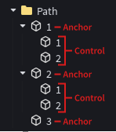

---
layout:
  width: default
  title:
    visible: true
  description:
    visible: false
  tableOfContents:
    visible: true
  outline:
    visible: true
  pagination:
    visible: true
  metadata:
    visible: true
  tags:
    visible: true
  actions:
    visible: true
  anchors:
    visible: true
---

# Paths, speed and length

When working with Bézier paths, such as for camera movement during cutscenes, you often want a consistent speed throughout inconsistent curve lengths.

Since tweens use durations rather than speeds, we have to convert our desired speed to a duration that fits the curve length. But that requires knowing the length of the curve.

For that I have written a super easy-to-use, highly accurate and optimized curve length approximation utility that supports all coordinate datatypes for both quadratic and cubic curves. It’s perfect to pair up with Tween+ and use for anything else you need.

<details>

<summary>GetCurveLength.luau</summary>

```luau
--!optimize 2

type Coordinate = Vector3 | Vector2 | CFrame | UDim2

local errorTolerance = 0.001 -- The lower, the higher accuracy.
local maxDepth = 8 -- Maximum subdivisions allowed to achieve desired accuracy.

local function calculateQuadraticCurveLength(startPoint, endPoint, controlPoint1, depth)
	local chordDistance = (endPoint - startPoint).Magnitude
	local hullDistance = (controlPoint1 - startPoint).Magnitude + (endPoint - controlPoint1).Magnitude
	
	-- Stop when desirably accurate.
	if (hullDistance - chordDistance) <= errorTolerance*chordDistance or depth >= maxDepth then
		return (chordDistance*2 + hullDistance)/3
	end
	
	-- Subdivide curve.
	local startToControlMidpoint = (startPoint + controlPoint1)*0.5
	local controlToEndMidpoint = (controlPoint1 + endPoint)*0.5
	
	local curveMidpoint = (startToControlMidpoint + controlToEndMidpoint)*0.5
	
	return calculateQuadraticCurveLength(startPoint, curveMidpoint, startToControlMidpoint, depth + 1)
		+ calculateQuadraticCurveLength(curveMidpoint, endPoint, controlToEndMidpoint, depth + 1)
end

local function calculateCubicCurveLength(startPoint, endPoint, controlPoint1, controlPoint2, depth)
	local chordDistance = (endPoint - startPoint).Magnitude
	local hullDistance =
		(controlPoint1 - startPoint).Magnitude
		+ (controlPoint2 - controlPoint1).Magnitude
		+ (endPoint - controlPoint2).Magnitude
	
	-- Stop when desirably accurate.
	if (hullDistance - chordDistance) <= errorTolerance*chordDistance or depth >= maxDepth then
		return (chordDistance*2 + hullDistance)/3
	end
	
	-- Subdivide curve.
	local startToControl1Midpoint = (startPoint + controlPoint1)*0.5
	local control1ToControl2Midpoint = (controlPoint1 + controlPoint2)*0.5
	local control2ToEndMidpoint = (controlPoint2 + endPoint)*0.5
	
	local leftBranchMidpoint = (startToControl1Midpoint + control1ToControl2Midpoint)*0.5
	local rightBranchMidpoint = (control1ToControl2Midpoint + control2ToEndMidpoint)*0.5
	
	local curveMidpoint = (leftBranchMidpoint + rightBranchMidpoint)*0.5
	
	return calculateCubicCurveLength(startPoint, curveMidpoint, startToControl1Midpoint, leftBranchMidpoint, depth + 1)
		+ calculateCubicCurveLength(curveMidpoint, endPoint, rightBranchMidpoint, control2ToEndMidpoint, depth + 1)
end

--[[
Takes a bezier path in the following format:
{ START, END, [CONTROL POINTS] }

And outputs the total length of the curve.
Uses the Gravesen Approximation Algorithm.
]]--
return function(startPoint: Coordinate, endPoint: Coordinate, controlPoint1: Coordinate, controlPoint2: Coordinate): number
	if not controlPoint1 then error("A minimum of 1 control point (quadratic) is required.", 2) end
	
	local dataType = typeof(startPoint)
	
	if dataType == "CFrame" then
		startPoint = startPoint.Position
		endPoint = endPoint.Position
		controlPoint1 = controlPoint1.Position
		if controlPoint2 then
			controlPoint2 = controlPoint2.Position
		end
	elseif dataType == "UDim2" then
		local viewportSize = workspace.CurrentCamera.ViewportSize
		local viewportWidth = viewportSize.X
		local viewportHeight = viewportSize.Y
		
		startPoint = Vector2.new(startPoint.X.Scale*viewportWidth + startPoint.X.Offset, startPoint.Y.Scale*viewportHeight + startPoint.Y.Offset)
		endPoint = Vector2.new(endPoint.X.Scale*viewportWidth + endPoint.X.Offset, endPoint.Y.Scale*viewportHeight + endPoint.Y.Offset)
		controlPoint1 = Vector2.new(controlPoint1.X.Scale*viewportWidth + controlPoint1.X.Offset, controlPoint1.Y.Scale*viewportHeight + controlPoint1.Y.Offset)
		if controlPoint2 then
			controlPoint2 = Vector2.new(controlPoint2.X.Scale*viewportWidth + controlPoint2.X.Offset, controlPoint2.Y.Scale*viewportHeight + controlPoint2.Y.Offset)
		end
	elseif dataType ~= "Vector3" and dataType ~= "Vector2" then
		error("'" .. dataType .. "' data type is not supported.", 2)
	end
	
	return if controlPoint2 then
		calculateCubicCurveLength(startPoint, endPoint, controlPoint1, controlPoint2, 0)
	else
		calculateQuadraticCurveLength(startPoint, endPoint, controlPoint1, 0)
end
```

</details>


#### How to use the length calculation utility and make Bézier paths

In the following example, we will be using this path structure:

<div align="left"><figure><figcaption><p>Each point contains control points<br>for the curve from it to the next.</p></figcaption></figure></div>

<pre class="language-luau"><code class="lang-luau">local Tween = require(script.Tween)
local getCurveLength = require(script.GetCurveLength)

local speed = 5 -- Studs per second.

local part = workspace.Part -- Object to move along the path.
local path = workspace.Path

-- This is where we start moving.
part.CFrame = path["1"].CFrame -- Move to the start of the path.
local currentPoint = 1
while true do
	local point = path:FindFirstChild(currentPoint)
<strong>	currentPoint += 1
</strong>	
	local endPoint = path:FindFirstChild(currentPoint)
	if endPoint then endPoint = endPoint.CFrame else break end -- Stop at the end of the path.
	
	local controlPoint1 = point:FindFirstChild("1")
	if controlPoint1 then controlPoint1 = controlPoint1.CFrame else error("Missing control point.") end
	local controlPoint2 = point:FindFirstChild("2")
	if controlPoint2 then controlPoint2 = controlPoint2.CFrame end
	
	-- Create and start the tween.
	local tween = Tween(part, {
		CFrame = {
			endPoint,
			controlPoint1,
			controlPoint2
		}
	}, {
		Time = getCurveLength( -- The neat utility I shared above!
			point.CFrame,
			endPoint,
			controlPoint1,
			controlPoint2
		)/speed, -- Divide length by speed for duration.
	}):Start().Completed:Wait() -- We continue first when this tween finishes.
end
</code></pre>
